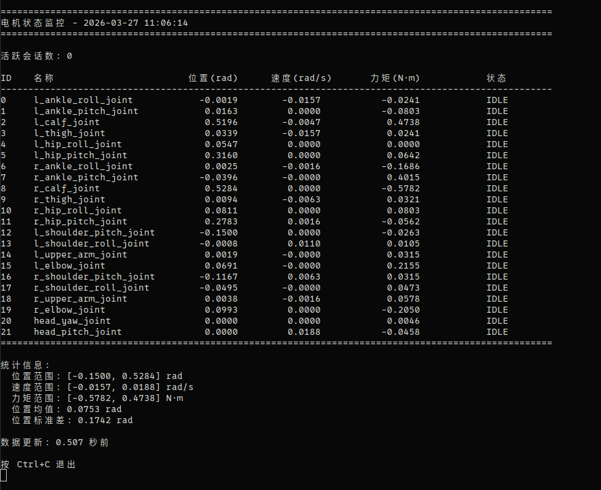
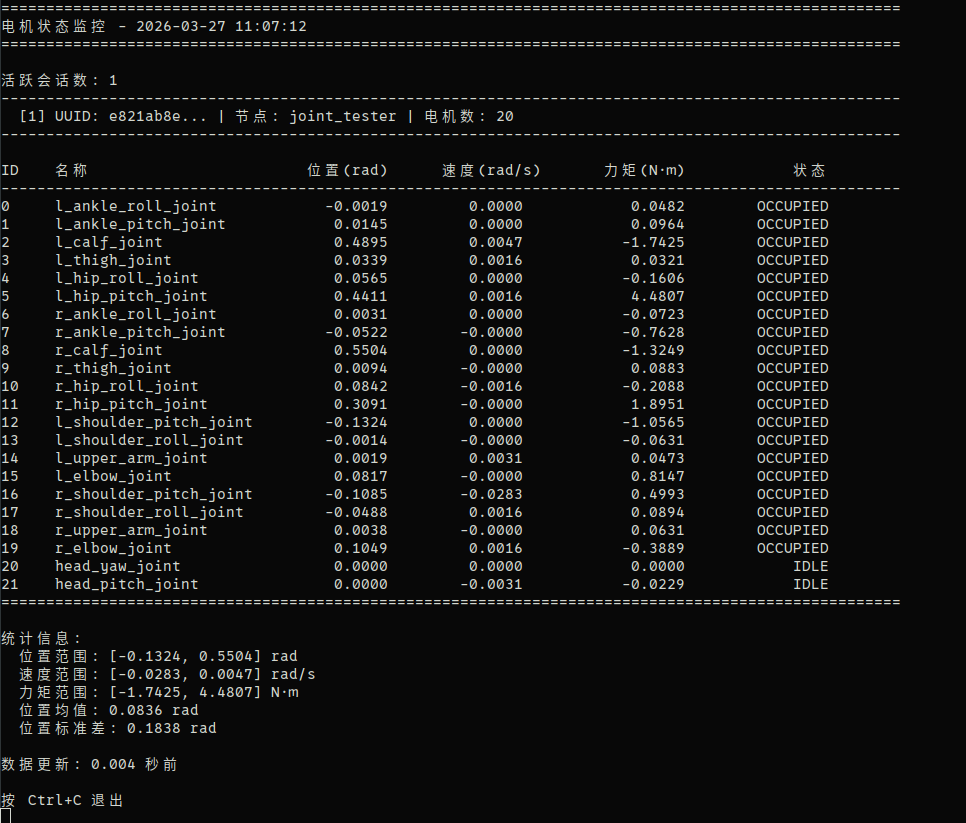

# hightorque_midware

Motor management node responsible for allocating motor control authority and providing position control, torque control, and mixed control interfaces via ROS 2 services/topics.

## Control Interface Overview

After startup, the following interfaces are available:

- Service: `/get_available_motors`
- Service: `/request_control`
- Service: `/release_control`
- Service: `/reset_zero`
- Topic: `/control_command`
- Topic: `/joint_states`
- Topic: `/session_status`

If you launch the node with a namespace, replace the root path in the examples below with your actual namespace.

### Control Mode Constants

- Position control: `hightorque_msgs/srv/RequestControl::POSITION_MODE = 0`
- Torque control: `hightorque_msgs/srv/RequestControl::TORQUE_MODE = 1`
- Mixed control: `hightorque_msgs/srv/RequestControl::MIXED_MODE = 2`

### Release/Timeout Behavior Constants

- `KEEP_MODE = 0`: Keep last command
- `DAMPING_MODE = 1`: Damping mode, recommended for debugging
- `ZERO_TORQUE_MODE = 2`: Zero torque

## Usage Flow

The flow is the same for position, torque, or mixed control:

1. Start `hightorque_midware_node`
2. Call `/request_control` to request motor control authority and obtain a `uuid`
3. Continuously publish control messages with the `uuid` to `/control_command`
4. Call `/release_control` to actively release control authority

## Important Notes

- In position control mode, `positions` is required and must match the length of `motor_ids`; `torques` will be ignored and treated as zero.
- In torque control mode, no need to pass `positions`, only `torques` is required with length matching `motor_ids`; `position/kp/kd` will be treated as zero.
- In mixed control mode, `positions`, `torques`, `kp`, `kd` must all match the length of `motor_ids`.
- In mixed control, for position-controlled motors: set `torques[i] = 0` and fill in `positions[i]`, `kp[i]`, `kd[i]`.
- In mixed control, for torque-controlled motors: set `positions[i] = 0`, `kp[i] = 0`, `kd[i] = 0` and fill in `torques[i]`.
- `velocities` can be empty or match the length of `motor_ids`.
- The examples below use motors '0', '1', '2', '3' for demonstration; when controlling more motors, extend all arrays to the same length.

## Starting Midware

```bash
# Use different launch files based on robot configuration
ros2 launch hightorque_bringup pi_plus_rknn.launch.py
```

You can also verify that interfaces are online:

```bash
ros2 service list | grep control
ros2 topic list | grep -E 'control_command|joint_states|session_status'
```

## Position Control

### Terminal Command Mode

1. Request position control authority:

```bash
ros2 service call /request_control \
  hightorque_msgs/srv/RequestControl \
  "{node_name: 'readme_position_cli', motor_ids: [0, 1, 2, 3], control_mode: 0, default_behavior: 1, timeout_ms: 5000, default_kp: [60.0, 60.0, 60.0, 60.0], default_kd: [1.0, 1.0, 1.0, 1.0]}"
```

Note the `uuid` in the response, referred to as `YOUR_UUID` below.

2. Continuously publish position control commands:

```bash
ros2 topic pub -r 100 /control_command hightorque_msgs/msg/MotorControlCommand \
  "{uuid: 'YOUR_UUID', motor_ids: [0, 1], positions: [0.2, -0.2, 0.2, -0.2], velocities: [], kp: [60.0, 60.0, 60.0, 60.0], kd: [1.0, 1.0, 1.0, 1.0], torques: []}"
```

3. Release control authority:

```bash
ros2 service call /release_control \
  hightorque_msgs/srv/ReleaseControl \
  "{node_name: 'readme_position_cli', uuid: 'YOUR_UUID', release_mode: 1}"
```

### Python Method

```python
import time

import rclpy
from rclpy.node import Node

from hightorque_msgs.msg import MotorControlCommand
from hightorque_msgs.srv import ReleaseControl, RequestControl


class MidwarePositionDemo(Node):
    def __init__(self):
        super().__init__('midware_position_demo')
        self.motor_ids = [0, 1, 2, 3]
        self.uuid = None

        self.request_client = self.create_client(RequestControl, '/request_control')
        self.release_client = self.create_client(ReleaseControl, '/release_control')
        self.cmd_pub = self.create_publisher(MotorControlCommand, '/control_command', 10)

    def wait_services(self):
        while not self.request_client.wait_for_service(timeout_sec=1.0):
            self.get_logger().info('waiting /request_control ...')
        while not self.release_client.wait_for_service(timeout_sec=1.0):
            self.get_logger().info('waiting /release_control ...')

    def request_control(self):
        req = RequestControl.Request()
        req.node_name = self.get_name()
        req.motor_ids = self.motor_ids
        req.control_mode = RequestControl.Request.POSITION_MODE
        req.default_behavior = RequestControl.Request.DAMPING_MODE
        req.timeout_ms = 5000
        req.default_kp = [60.0] * len(req.motor_ids)
        req.default_kd = [1.0] * len(req.motor_ids)

        future = self.request_client.call_async(req)
        rclpy.spin_until_future_complete(self, future)
        resp = future.result()
        if resp is None or not resp.success:
            self.get_logger().error(f'request_control failed: {resp.message if resp else "no response"}')
            return False

        self.uuid = resp.uuid
        self.get_logger().info(f'control granted, uuid={self.uuid}')
        return True

    def publish_position(self, positions):
        msg = MotorControlCommand()
        msg.uuid = self.uuid
        msg.motor_ids = self.motor_ids
        msg.positions = positions
        msg.velocities = []
        msg.kp = [60.0, 60.0, 60.0, 60.0]
        msg.kd = [1.0, 1.0, 1.0, 1.0]
        msg.torques = []
        self.cmd_pub.publish(msg)

    def release_control(self):
        req = ReleaseControl.Request()
        req.node_name = self.get_name()
        req.uuid = self.uuid
        req.release_mode = ReleaseControl.Request.DAMPING_MODE

        future = self.release_client.call_async(req)
        rclpy.spin_until_future_complete(self, future)
        resp = future.result()
        if resp is not None:
            self.get_logger().info(f'release_control: success={resp.success}, message={resp.message}')


def main():
    rclpy.init()
    node = MidwarePositionDemo()
    node.wait_services()

    try:
        if not node.request_control():
            return

        for _ in range(500):
            node.publish_position([0.2, -0.2, 0.2, -0.2])
            rclpy.spin_once(node, timeout_sec=0.0)
            time.sleep(0.1)
    finally:
        if node.uuid:
            node.release_control()
        node.destroy_node()
        rclpy.shutdown()


if __name__ == '__main__':
    main()
```

### C++ Method

```cpp
#include <chrono>
#include <memory>
#include <string>
#include <thread>
#include <vector>

#include <rclcpp/rclcpp.hpp>

#include "hightorque_msgs/msg/motor_control_command.hpp"
#include "hightorque_msgs/srv/release_control.hpp"
#include "hightorque_msgs/srv/request_control.hpp"

class MidwarePositionDemo : public rclcpp::Node
{
public:
    MidwarePositionDemo()
        : Node("midware_position_demo"), motor_ids_{0, 1, 2, 3}
    {
        request_client_ = create_client<hightorque_msgs::srv::RequestControl>("/request_control");
        release_client_ = create_client<hightorque_msgs::srv::ReleaseControl>("/release_control");
        cmd_pub_ = create_publisher<hightorque_msgs::msg::MotorControlCommand>("/control_command", 10);
    }

    bool requestControl()
    {
        auto req = std::make_shared<hightorque_msgs::srv::RequestControl::Request>();
        req->node_name = get_name();
        req->motor_ids = motor_ids_;
        req->control_mode = hightorque_msgs::srv::RequestControl::Request::POSITION_MODE;
        req->default_behavior = hightorque_msgs::srv::RequestControl::Request::DAMPING_MODE;
        req->timeout_ms = 5000;
        req->default_kp = {60.0f, 60.0f, 60.0f, 60.0f};
        req->default_kd = {1.0f, 1.0f, 1.0f, 1.0f};

        auto future = request_client_->async_send_request(req);
        if (rclcpp::spin_until_future_complete(shared_from_this(), future) !=
            rclcpp::FutureReturnCode::SUCCESS)
        {
            RCLCPP_ERROR(get_logger(), "request_control failed");
            return false;
        }

        auto resp = future.get();
        if (!resp->success)
        {
            RCLCPP_ERROR(get_logger(), "request_control rejected: %s", resp->message.c_str());
            return false;
        }

        uuid_ = resp->uuid;
        RCLCPP_INFO(get_logger(), "control granted, uuid=%s", uuid_.c_str());
        return true;
    }

    void publishPosition(const std::vector<float>& positions)
    {
        hightorque_msgs::msg::MotorControlCommand msg;
        msg.uuid = uuid_;
        msg.motor_ids = motor_ids_;
        msg.positions = positions;
        msg.velocities = {};
        msg.kp = {60.0f, 60.0f, 60.0f, 60.0f};
        msg.kd = {1.0f, 1.0f, 1.0f, 1.0f};
        msg.torques = {};
        cmd_pub_->publish(msg);
    }

    void releaseControl()
    {
        auto req = std::make_shared<hightorque_msgs::srv::ReleaseControl::Request>();
        req->node_name = get_name();
        req->uuid = uuid_;
        req->release_mode = hightorque_msgs::srv::ReleaseControl::Request::DAMPING_MODE;
        release_client_->async_send_request(req);
    }

private:
    std::vector<int32_t> motor_ids_;
    std::string uuid_;
    rclcpp::Client<hightorque_msgs::srv::RequestControl>::SharedPtr request_client_;
    rclcpp::Client<hightorque_msgs::srv::ReleaseControl>::SharedPtr release_client_;
    rclcpp::Publisher<hightorque_msgs::msg::MotorControlCommand>::SharedPtr cmd_pub_;
};

int main(int argc, char** argv)
{
    rclcpp::init(argc, argv);
    auto node = std::make_shared<MidwarePositionDemo>();

    if (node->requestControl())
    {
        for (int i = 0; i < 500; ++i)
        {
            node->publishPosition({0.0f, 0.0f, 0.0f, 0.0f});
            rclcpp::spin_some(node);
            std::this_thread::sleep_for(std::chrono::milliseconds(10));
        }
        node->releaseControl();
    }

    rclcpp::shutdown();
    return 0;
}
```

## Torque Control

"Torque control" corresponds to `control_mode = 1`. Internally it still sends `MotorControlType::POS_VEL_TQE_KP_KD`, but with `kp/kd` set to zero; output is primarily controlled via `torques`. Therefore:

- Torque control does not require `positions`
- `torques` is the primary torque input
- `kp/kd` are not required; even if passed, midware treats them as zero

### Terminal Command Mode

1. Request torque control authority:

```bash
ros2 service call /request_control \
  hightorque_msgs/srv/RequestControl \
  "{node_name: 'readme_torque_cli', motor_ids: [0, 1, 2, 3, 4, 5], control_mode: 1, default_behavior: 1, timeout_ms: 50000, default_kp: [0.0, 0.0, 0.0, 0.0, 0.0, 0.0], default_kd: [0.0, 0.0, 0.0, 0.0, 0.0, 0.0]}"
```

2. Continuously publish torque control commands:

```bash
ros2 topic pub -r 100 /control_command hightorque_msgs/msg/MotorControlCommand \
  "{uuid: 'YOUR_UUID', motor_ids: [0, 1, 2, 3, 4, 5], positions: [], velocities: [], kp: [], kd: [], torques: [0.5, 0.5, 0.5, 0.5, 0.5, 0.5]}"
```

3. Release control authority:

```bash
ros2 service call /release_control \
  hightorque_msgs/srv/ReleaseControl \
  "{node_name: 'readme_torque_cli', uuid: 'YOUR_UUID', release_mode: 1}"
```

### Python Method

```python
import time
import rclpy
from rclpy.node import Node
from hightorque_msgs.msg import MotorControlCommand
from hightorque_msgs.srv import ReleaseControl, RequestControl

class MidwareTorqueDemo(Node):
    def __init__(self):
        super().__init__('midware_torque_demo')
        self.motor_ids = [0, 1, 2, 3]
        self.uuid = None
        self.request_client = self.create_client(RequestControl, '/request_control')
        self.release_client = self.create_client(ReleaseControl, '/release_control')
        self.cmd_pub = self.create_publisher(MotorControlCommand, '/control_command', 10)

    def request_control(self):
        req = RequestControl.Request()
        req.node_name = self.get_name()
        req.motor_ids = self.motor_ids
        req.control_mode = RequestControl.Request.TORQUE_MODE
        req.default_behavior = RequestControl.Request.DAMPING_MODE
        req.timeout_ms = 5000
        req.default_kp = [0.0] * len(req.motor_ids)
        req.default_kd = [0.0] * len(req.motor_ids)
        future = self.request_client.call_async(req)
        rclpy.spin_until_future_complete(self, future)
        resp = future.result()
        if resp is None or not resp.success:
            return False
        self.uuid = resp.uuid
        return True

    def publish_torque(self, torques):
        msg = MotorControlCommand()
        msg.uuid = self.uuid
        msg.motor_ids = self.motor_ids
        msg.positions = []
        msg.velocities = []
        msg.kp = []
        msg.kd = []
        msg.torques = torques
        self.cmd_pub.publish(msg)

    def release_control(self):
        req = ReleaseControl.Request()
        req.node_name = self.get_name()
        req.uuid = self.uuid
        req.release_mode = ReleaseControl.Request.DAMPING_MODE
        future = self.release_client.call_async(req)
        rclpy.spin_until_future_complete(self, future)

def main():
    rclpy.init()
    node = MidwareTorqueDemo()
    try:
        if node.request_control():
            for _ in range(500):
                node.publish_torque([0.15, -0.15, 0.15, -0.15])
                rclpy.spin_once(node, timeout_sec=0.0)
                time.sleep(0.1)
    finally:
        if node.uuid:
            node.release_control()
        node.destroy_node()
        rclpy.shutdown()

if __name__ == '__main__':
    main()
```

### C++ Method

```cpp
class MidwareTorqueDemo : public rclcpp::Node
{
public:
    MidwareTorqueDemo() : Node("midware_torque_demo"), motor_ids_{0, 1}
    {
        request_client_ = create_client<hightorque_msgs::srv::RequestControl>("/request_control");
        release_client_ = create_client<hightorque_msgs::srv::ReleaseControl>("/release_control");
        cmd_pub_ = create_publisher<hightorque_msgs::msg::MotorControlCommand>("/control_command", 10);
    }

    bool requestControl()
    {
        auto req = std::make_shared<hightorque_msgs::srv::RequestControl::Request>();
        req->node_name = get_name();
        req->motor_ids = motor_ids_;
        req->control_mode = hightorque_msgs::srv::RequestControl::Request::TORQUE_MODE;
        req->default_behavior = hightorque_msgs::srv::RequestControl::Request::DAMPING_MODE;
        req->timeout_ms = 5000;
        req->default_kp = {0.0f, 0.0f};
        req->default_kd = {0.0f, 0.0f};
        auto future = request_client_->async_send_request(req);
        if (rclcpp::spin_until_future_complete(shared_from_this(), future) != rclcpp::FutureReturnCode::SUCCESS)
            return false;
        auto resp = future.get();
        if (!resp->success) return false;
        uuid_ = resp->uuid;
        return true;
    }

    void publishTorque(const std::vector<float>& torques)
    {
        hightorque_msgs::msg::MotorControlCommand msg;
        msg.uuid = uuid_;
        msg.motor_ids = motor_ids_;
        msg.torques = torques;
        cmd_pub_->publish(msg);
    }

    void releaseControl()
    {
        auto req = std::make_shared<hightorque_msgs::srv::ReleaseControl::Request>();
        req->node_name = get_name();
        req->uuid = uuid_;
        req->release_mode = hightorque_msgs::srv::ReleaseControl::Request::DAMPING_MODE;
        release_client_->async_send_request(req);
    }

private:
    std::vector<int32_t> motor_ids_;
    std::string uuid_;
    rclcpp::Client<hightorque_msgs::srv::RequestControl>::SharedPtr request_client_;
    rclcpp::Client<hightorque_msgs::srv::ReleaseControl>::SharedPtr release_client_;
    rclcpp::Publisher<hightorque_msgs::msg::MotorControlCommand>::SharedPtr cmd_pub_;
};
```

## Mixed Control

"Mixed control" corresponds to `control_mode = 2`. Each motor's mode is determined by the arrays you pass:

- Position-controlled motors: `torques[i] = 0`, set `positions[i]`, `kp[i]`, `kd[i]`
- Torque-controlled motors: `positions[i] = 0`, `kp[i] = 0`, `kd[i] = 0`, set `torques[i]`
- `positions`, `torques`, `kp`, `kd` must all match the length of `motor_ids`

### Terminal Command Mode

Motors `0`, `1` use torque control; motors `2`, `3` use position control:

```bash
ros2 service call /request_control \
  hightorque_msgs/srv/RequestControl \
  "{node_name: 'readme_mixed_cli', motor_ids: [0, 1, 2, 3], control_mode: 2, default_behavior: 1, timeout_ms: 5000, default_kp: [0.0, 0.0, 60.0, 60.0], default_kd: [0.0, 0.0, 1.0, 1.0]}"
```

```bash
ros2 topic pub -r 100 /control_command hightorque_msgs/msg/MotorControlCommand \
  "{uuid: 'YOUR_UUID', motor_ids: [0, 1, 2, 3], positions: [0.0, 0.0, 0.2, -0.2], velocities: [0.0, 0.0, 0.0, 0.0], kp: [0.0, 0.0, 60.0, 60.0], kd: [0.0, 0.0, 1.0, 1.0], torques: [0.15, 0.10, 0.0, 0.0]}"
```

```bash
ros2 service call /release_control \
  hightorque_msgs/srv/ReleaseControl \
  "{node_name: 'readme_mixed_cli', uuid: 'YOUR_UUID', release_mode: 1}"
```

## Zero-Point Calibration

### Overview

The `/reset_zero` service sets the current position of all motors as the zero point, persisted internally.

**Prerequisites:**
- midware node is running
- No active control sessions (all nodes must release control first)
- Motors are in a communicable state

**Notes:**
- Motors are set to zero torque during calibration; ensure the robot is on its zero-point stand
- Default timeout is 10000ms, adjustable via `timeout_ms`
- Calibration is complete when all motors report position absolute value ≤ 0.1 rad
- Power cycle the motors regardless of success or failure

**Service definition:**

```
# Request
int32 timeout_ms    # Timeout in ms; <= 0 uses default 10000ms
---
# Response
bool success
uint8 status        # 0=FAILED  1=SUCCEEDED  2=TIMEOUT
string message
```

### Terminal Command

```bash
ros2 service call /reset_zero \
  hightorque_msgs/srv/ResetZero \
  "{timeout_ms: 10000}"
```

## Utility Scripts

### Motor Status Monitor

`scripts/monitor_motors.py` provides real-time motor status monitoring:
- Active control sessions (UUID, node name, motor count)
- Position, velocity, and torque of each motor
- Motor occupancy status (IDLE/OCCUPIED/ERROR)

```bash
# Continuous monitoring (default, updates every second)
python3 scripts/monitor_motors.py

# Single query
python3 scripts/monitor_motors.py once

# Motor info only
python3 scripts/monitor_motors.py info
```




